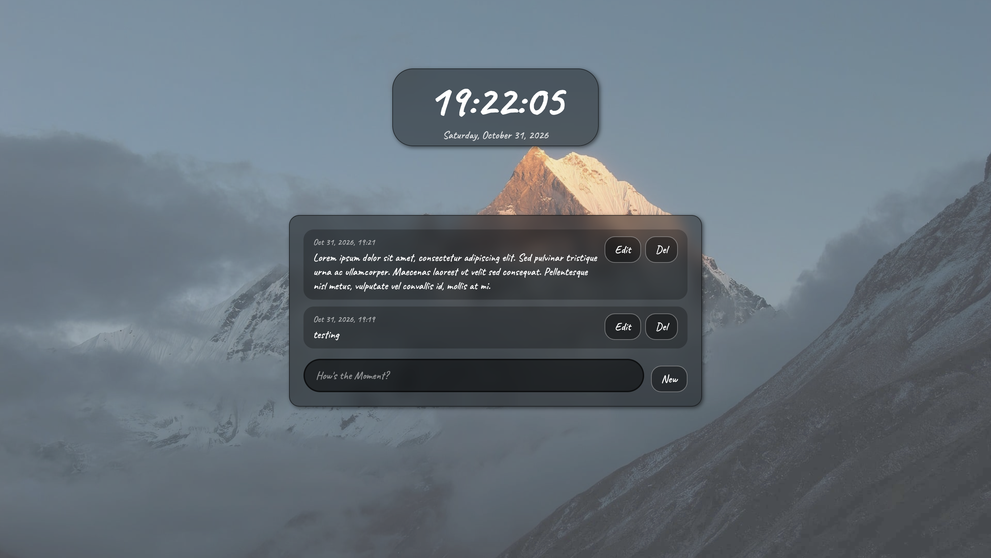
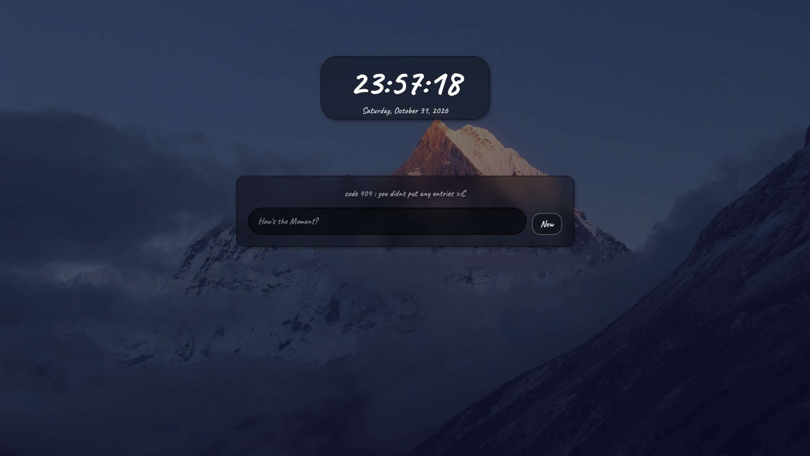

<h1>Connection v1</h1>
<h3>what it is + preview</h3>

Connection is a website that shows local time , and allows you to log the moment to remember it later (saves locally for now), with a changing background overlay to match time(built with html , css and js)

 

 

<h3>how to use</h3>

go to <a href="https://nozomi-rou.github.io/Connection/">this website </a> , to add logs write your log then press new , to delete go to desired log and press del

<h3>credits</h3>
<h2> the honored ones:</h2>

faeroc(dung desciple #2) , airfrier : screenshots and testing  
<a href="https://www.youtube.com/watch?v=KVP2N-KutnQ">codexalt (the guy who made this video)</a>
 
stardance: for being the reason this project was ever made

<h2>coding knowledge</h2>

<a href="https://developer.mozilla.org/en-US/">mdn mozzila (which has always been my fav place)</a>  
<a href="https://www.theodinproject.com/">the odin project (check it out , its the best for newbies, also links to mozzila)</a>
  <a href="https://www.youtube.com/watch?v=-v36WcbDs9k"> this guy , whom without there would have been no clock</a>

Image by <a href="https://pixabay.com/users/yaomuyu-57712153/?utm_source=link-attribution&utm_medium=referral&utm_campaign=image&utm_content=10489623">YaoMuyu</a> from <a href="https://pixabay.com//?utm_source=link-attribution&utm_medium=referral&utm_campaign=image&utm_content=10489623">Pixabay</a>

 
 
 

side not : whoever tries to read my code , goodluck, i wrote it like that so ai cant scrap it like it does to most git repos
